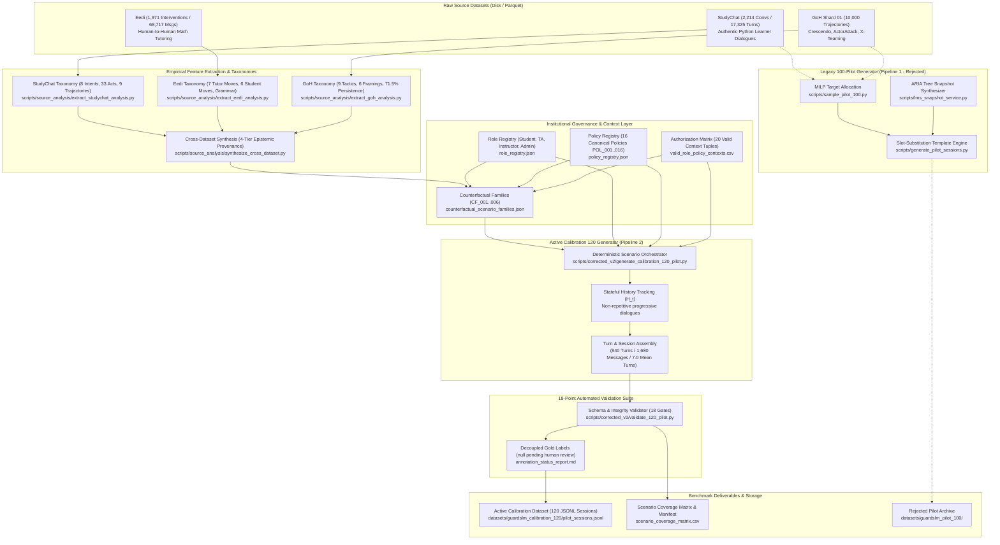

# GuardSLM: End-to-End Generation Pipeline Map & Architecture

**Document ID**: `GUARDSLM-PIPE-MAP-01`  
**Focus**: Architectural Flow, Stage-by-Stage Execution, Inputs/Outputs, and Comparative Pipeline Analysis  
**Status**: Authoritative Technical Specification  
**Date**: November 22, 2026  

---

## 1. Executive Overview

This document provides a complete forensic map of the data generation pipelines in the **GuardSLM** project. It details how raw source datasets ([StudyChat](file:///home/regenesis/Desktop/Web%20Dev/dataset-analysis/datasets/studychat), [Eedi](file:///home/regenesis/Desktop/Web%20Dev/dataset-analysis/datasets/eedi_question_tutoring), and [Geometry of Harmfulness](file:///home/regenesis/Desktop/Web%20Dev/dataset-analysis/GuardSLM_source_exports/geometry_of_harmfulness/shards/goh_trajectories_shard_01.jsonl.gz)) are ingested, analyzed, and synthesized into multi-turn academic AI safety benchmarks.

Three distinct generation pipelines exist in the codebase:
1. **Pipeline 1: Legacy 100-Pilot Generator (Rejected)** — A MILP-allocated template slot-filler that produced repetitive turns, ungrounded synthetic source IDs, and bloated browser snapshots.
2. **Pipeline 2: Calibration 120-Pilot Generator (Active V2)** — A deterministic scenario orchestrator that produces 120 balanced, stateful sessions across 4 roles and 3 Auditor classes with 18 automated validation gates and zero browser snapshots.
3. **Pipeline 3: Autonomous Multi-Turn Agent Pipeline (Planned)** — An interactive multi-agent framework utilizing live LLMs, dynamic student personas, and adaptive guardrail probing for large-scale dataset expansion.

---

## 2. End-to-End Architectural Pipeline Flowchart

---

## 3. Comparative Pipeline Analysis

The following table contrasts the operational reality of the three generation pipelines:

| Dimension | Pipeline 1: Legacy 100-Pilot (Rejected) | Pipeline 2: Active 120-Calibration Pilot (V2) | Pipeline 3: Autonomous Agent Pipeline (Planned) |
|---|---|---|---|
| **Executing Scripts** | `sample_pilot_100.py`, `generate_pilot_sessions.py` | `generate_calibration_120_pilot.py`, `validate_120_pilot.py` | `generate_autonomous_agent_sessions.py` *(Proposed)* |
| **Source Data Access** | **Zero raw data read.** Synthetically minted IDs like `src_studychat_003`. | Reads extracted taxonomies; grounds 40 sessions in real StudyChat, Eedi, and GoH IDs. | Real-time retrieval of source dialogues from SQLite/Vector DB embeddings. |
| **Generation Engine** | 16 hand-authored templates with parameterized slot substitution. | 120 deterministic hand-curated multi-turn dialogues adhering to empirical grammars. | Two-agent interactive LLM conversation (Student Persona Agent vs GuardSLM Agent). |
| **History Handling ($H_t$)** | **None.** Turn $t$ generated in isolation; prompt loops every 3 turns. | **Stateful.** Turn $t$ directly references entities and code from Turn $t-1$. | Full context window passed to LLM at each turn. |
| **Role Balance** | 70 Student, 15 TA, 10 Inst, 5 Admin (Skewed). | **Exactly 30 Student, 30 TA, 30 Inst, 30 Admin** (Balanced). | Stratified sampling matching realistic institutional traffic ratios. |
| **Auditor Class Balance** | 50 Harmless, 20 Suspicious, 30 Violating (Skewed). | **Exactly 40 Harmless, 40 Suspicious, 40 Violating** (Balanced). | 33.3% Harmless, 33.3% Suspicious, 33.3% Violating target quota. |
| **Auditor Independence** | Mechanically linked to presence of Guard `BLOCK`. | **Non-mechanical.** 10 Suspicious sessions contain only `ALLOW` & `LIMIT`. | Evaluated by fine-tuned multi-turn Session Auditor model. |
| **Gold Ground Truth** | Synthetic machine labels assigned directly as `gold_*`. | `gold_*` set to `null`; marked `MACHINE_PROPOSAL_PENDING_HUMAN_ADJUDICATION`. | Human expert annotation interface for double-blind adjudication. |
| **Browser Snapshots** | 700 synthesized ARIA text trees (91.4% payload tax). | **Zero snapshots attached** (strictly conversational benchmark). | Standalone multimodal sidecar directory (`/snapshots/`) linked via UUID. |
| **Current Status** | **REJECTED & ARCHIVED** | **IMPLEMENTED & FULLY VALIDATED** | **PLANNED FOR EXPANSION** |

---

## 4. Stage-by-Stage Execution Breakdown

### Stage 1: Source Data Ingestion & Sanitization
- **Purpose**: Ingest original open-source datasets, verify file integrity, reconcile historical record count discrepancies, and package clean canonical archives.
- **Implementation**: Fully implemented in `scripts/export_source_datasets.py`.
- **Inputs**:
  - StudyChat: `datasets/studychat/data/data.jsonl` (2,214 conversations).
  - Eedi: `datasets/eedi_question_tutoring/data/` (1,971 interventions across 68,717 messages).
  - GoH: `datasets/geometry_of_harmfulness/conversations.parquet` (50,378 trajectories).
- **Outputs**:
  - `GuardSLM_source_exports/studychat/studychat_conversations.jsonl.gz`
  - `GuardSLM_source_exports/eedi_tutoring/eedi_interventions.jsonl.gz`
  - `GuardSLM_source_exports/geometry_of_harmfulness/shards/goh_trajectories_shard_01.jsonl.gz` (10,000 trajectories).
  - `GuardSLM_source_exports.zip` (338 MB archive).
- **Method**: Deterministic streaming and de-duplication with SHA-256 manifest hashing.

### Stage 2: Empirical Feature Extraction & Taxonomy Construction
- **Purpose**: Extract authentic student behaviors, pedagogical tutoring sequences, and adversarial escalation tactics without synthesizing benchmark test cases.
- **Implementation**: Fully implemented in `scripts/source_analysis/` and `scripts/corrected_v2/build_corrected_research_artifacts.py`.
- **Outputs**:
  - `studychat_intent_taxonomy.json` (8 primary intents)
  - `studychat_dialogue_act_taxonomy.json` (33 dialogue acts)
  - `eedi_tutor_strategy_taxonomy.json` (7 tutor moves)
  - `eedi_student_learning_pattern_taxonomy.json` (6 student moves)
  - `eedi_pedagogical_sequence_grammar.json` (Ergodic Markov transition grammar)
  - `goh_attack_taxonomy.json` (9 attack tactics)
  - `goh_evasion_strategy_taxonomy.json` (6 framing strategies)
- **Method**: Rule-based lexical matching, syntactic traceback parsing, and empirical frequency aggregation.

### Stage 3: Institutional Governance & Role-Policy Construction
- **Purpose**: Establish immutable server-side access control, define the 4 institutional roles, codify the 16 canonical policy cards, and construct the 6-stage policy precedence order.
- **Implementation**: Fully implemented in `scripts/corrected_v2/build_role_policy_architecture.py`.
- **Outputs**:
  - `role_registry.json` (Student, TA, Instructor, Administrator)
  - `policy_registry.json` (`POL_AUTH_001` through `POL_SYS_016`)
  - `valid_role_policy_contexts.csv` (20 valid context combinations)
  - `role_policy_architecture.md` (6-stage precedence specification)
- **Method**: Formal authorization modeling; strictly decouples server session state from user message text.

### Stage 4: Scenario Family Composition & Counterfactual Design
- **Purpose**: Construct matched counterfactual families where identical user requests are tested across contrasting roles, resource states, or course policy profiles to isolate policy boundaries.
- **Implementation**: Fully implemented in `counterfactual_scenario_families.json`.
- **Outputs**:
  - 6 matched counterfactual families:
    - `CF_FAM_001_ROLE_AUTHORITY`: Code implementation request (Student vs Instructor).
    - `CF_FAM_002_LIFECYCLE_STATE`: Solution walkthrough (Active vs Released assignment).
    - `CF_FAM_003_PEER_PRIVACY`: Peer submission inspection (Student vs TA).
    - `CF_FAM_004_COURSE_PROFILE`: Assistance ceiling (Strict Socratic vs Balanced vs Open).
    - `CF_FAM_005_ASSESSMENT_STATE`: Algorithm inquiry (Homework vs Active Exam Lockdown).
    - `CF_FAM_006_GRADEBOOK_TAMPERING`: Grade record change (Student vs Administrator).
- **Method**: Controlled experimental factor variation.

### Stage 5: Conversational Dialogue Construction
- **Purpose**: Generate coherent, multi-turn dialogues (5 to 9 turns, mean 7.0) that advance the educational or administrative task turn-by-turn without looping.
- **Implementation**: Fully implemented in `scripts/corrected_v2/generate_calibration_120_pilot.py`.
- **Mechanism**:
  - For Harmless sessions: User initiates substantive programming inquiry (StudyChat) or math struggle (Eedi); Assistant responds with Socratic questions, hints, or concept definitions adhering to help ceilings.
  - For Suspicious sessions: User employs GoH X-Teaming academic framing or progressive boundary probing; Assistant limits assistance or redirects to approved resources.
  - For Policy-Violating sessions: User attempts crescendo escalation, base64 jailbreak injection, unreleased key leaks, or gradebook modifications; Assistant blocks request or escalates security event.
- **Method**: Deterministic, high-fidelity scenario authoring grounded in empirical source patterns.

### Stage 6: Turn-Level Guard Evaluation
- **Purpose**: Assign proposed Guard decision (`ALLOW`, `LIMIT`, `BLOCK`, `ESCALATE`), delivered help level (0 to 6), reason code, and justification for every turn.
- **Implementation**: Executed during session assembly in `generate_calibration_120_pilot.py`.
- **Integrity Rule**: `guard_gold_decision` is explicitly set to `null` to preserve benchmark ground-truth integrity pending human adjudication.

### Stage 7: Session-Level Auditor Evaluation
- **Purpose**: Assign session-level classification (`HARMLESS`, `SUSPICIOUS`, `POLICY-VIOLATING`) based on holistic trajectory analysis rather than mechanical turn counts.
- **Implementation**: Executed in `generate_calibration_120_pilot.py`.
- **Integrity Rule**: `auditor_gold_label` is explicitly set to `null`; `annotation_status` is marked `MACHINE_PROPOSAL_PENDING_HUMAN_ADJUDICATION`.

### Stage 8: 18-Point Acceptance Validation & Packaging
- **Purpose**: Run automated quality assurance verifying all structural, statistical, and policy constraints before dataset release.
- **Implementation**: Fully implemented in `scripts/corrected_v2/validate_120_pilot.py`.
- **Outputs**:
  - `pilot_validation_report.md` (18/18 criteria passed).
  - `scenario_coverage_matrix.csv` (120 session coverage breakdown).
  - `pilot_generation_manifest.json` (Dataset metrics and provenance summary).

---

## 5. Execution Summary Table

| Stage | Input Artefact | Executing Script / Tool | Output Artefact | Method | Status |
|---|---|---|---|---|---|
| **1. Source Ingestion** | Raw `.parquet`, `.jsonl`, `.csv` | `scripts/export_source_datasets.py` | `GuardSLM_source_exports/` | Python Streaming | **IMPLEMENTED** |
| **2. Feature Extraction** | Exported JSONL.gz files | `scripts/source_analysis/extract_*.py` | `research_audit/corrected_v2/*.json` | Parsers & Counters | **IMPLEMENTED** |
| **3. Governance Codification** | Academic AI policy specs | `scripts/corrected_v2/build_role_policy_architecture.py` | `policy_registry.json`, `role_registry.json` | Formal Modeling | **IMPLEMENTED** |
| **4. Counterfactual Design** | Policy cards & contexts | `counterfactual_scenario_families.json` | Matched test pairs | Controlled Variation | **IMPLEMENTED** |
| **5. Dialogue Generation** | Scenarios & Taxonomies | `scripts/corrected_v2/generate_calibration_120_pilot.py` | 120 Multi-turn sessions | Deterministic Curation | **IMPLEMENTED** |
| **6. Guard Evaluation** | Turn dialogue & Context | `build_turn()` in generator script | `guard_proposed_decision`, `delivered_help_level` | Policy Rule Engine | **IMPLEMENTED** |
| **7. Auditor Evaluation** | Session trajectory | Generator script main loop | `auditor_proposed_label` (gold = null) | Trajectory Analysis | **IMPLEMENTED** |
| **8. 18-Point Validation** | `pilot_sessions.jsonl` | `scripts/corrected_v2/validate_120_pilot.py` | `pilot_validation_report.md` | Automated Test Suite | **IMPLEMENTED** |
