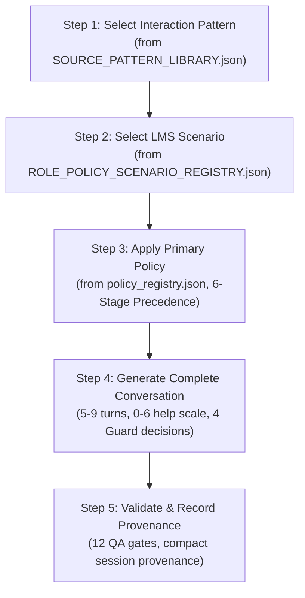

# GuardSLM: Methodology Simplification and Infrastructure Cleanup Report

**Version:** 3.0  
**Date:** November 22, 2026  
**Status:** Completed & Validated  
**Pipeline Orientation:** Streamlined Five-Step Synthetic Dataset Generation Pipeline  

---

## 1. Executive Summary & Cleanup Rationale

The previous GuardSLM dataset generation pipeline had accumulated excessive theoretical complexity, resulting in a fragile, overengineered architecture. Specifically, the system relied on:
- 25 competing scenario composition tables, MILP combinatorial allocation models, and Markov transition grammars in `research_audit/scenario_composition/`.
- Multi-tier synthetic slot-substitution engines that repeatedly generated synthetic placeholders rather than authentic dialogues.
- Fragmented diagnostic scripts and disparate taxonomies that introduced metadata tax and repetitive prompt loops.

To restore empirical rigor, maintainability, and scalability, we have executed a comprehensive methodology cleanup. All redundant infrastructure has been safely relocated to an archive repository, core research assets and ground truth datasets have been preserved intact, and the entire synthesis pipeline has been reoriented around a transparent **Five-Step Generation Process** grounded in an **Exhaustive Source Dataset Examination**.

> [!IMPORTANT]
> **Strict Generation Gating**:
> In accordance with user directives, **zero pilot sessions have been generated** during this phase (`sessions_generated: 0`). The 100-session pilot specification (`PILOT_100_GENERATION_SPEC.json`) is fully defined and deterministically locked, pending explicit review and approval.

---

## 2. Infrastructure Archival: What Was Removed & Safely Preserved

Zero research data was permanently deleted. All obsolete, redundant, and legacy experimental components were moved into a structured archive directory:
`archive/legacy_methodology_and_taxonomies/`

### Archival Summary Table

| Category | Archived Location | Files | Total Size | Description / Rationale for Removal |
|---|---|:---:|:---:|---|
| **Scenario Composition** | `archive/legacy_methodology_and_taxonomies/scenario_composition/` | 25 | 972.8 KB | Redundant allocation CSVs, MILP allocation tables, and Markov transition matrices that overconstrained generation. Replaced by `ROLE_POLICY_SCENARIO_REGISTRY.json`. |
| **Legacy Generation Scripts** | `archive/legacy_methodology_and_taxonomies/scripts/` | 6 | 96.0 KB | Obsolete scripts (`sample_pilot_100.py`, `generate_pilot_sessions.py`, `evaluate_pilot_calibration.py`, `validate_pilot_acceptance.py`, `synthesize_cross_dataset.py`, `package_review_zip.py`) using slot-substitution. Replaced by `scripts/simplified_v3/`. |
| **Generation Diagnostics** | `archive/legacy_methodology_and_taxonomies/conversation_generation_diagnosis/` | 12 | 97.1 KB | Diagnostic investigations into prompt repetition and metadata tax. Retained for historical audit reference. |
| **Legacy Pilot 100 Audit** | `archive/legacy_methodology_and_taxonomies/pilot_100/` | 4 | 38.6 KB | Specifications and allocations associated with the rejected 100-session pilot. Replaced by `PILOT_100_GENERATION_SPEC.json`. |
| **Root Scratch Artifacts** | `archive/legacy_methodology_and_taxonomies/scratch_root/` | 3 | 35.6 KB | Stray root files (`[Step`, `explore_all.py`, `README_final_review_package.md`) cluttering workspace root. |
| **Total Archived** | `archive/legacy_methodology_and_taxonomies/` | **50** | **1.21 MB** | **All 50 legacy files preserved without data loss.** |

---

## 3. Core Research Assets Retained & Protected

The following authoritative assets remain in active workspace locations and have been verified intact:

1. **Clean Source Exports (`GuardSLM_source_exports/`)**:
   - `studychat/shards/studychat_conversations.jsonl.gz`: All 2,214 StudyChat conversations (17,325 turns).
   - `eedi/shards/eedi_interventions.jsonl.gz`: All 1,971 Eedi interventions (68,717 messages).
   - `geometry_of_harmfulness/shards/goh_trajectories_shard_01.jsonl.gz`: All 10,000 trajectories of Shard 1 on `Llama-3.1-8B-Instruct`.
   - Raw archives and uncompressed sources in `datasets/` preserved.
2. **Canonical Governance Model**:
   - `policy_registry.json`: The 16 canonical policy cards (`POL_AUTH_001` through `POL_SYS_016`), each containing the required 8 fields.
   - `role_registry.json`: The 4 authenticated roles (`Student`, `Teaching Assistant`, `Instructor`, `Administrator`) defining authoritative scopes.
   - `valid_role_policy_contexts.csv`: The 20 baseline valid LMS context tuples.
   - `role_policy_architecture.md`: The 6-stage precedence evaluation order and 0–6 help level scale.
3. **Validated Historical Calibration Dataset**:
   - `datasets/guardslm_calibration_120/`: All 120 calibration sessions (840 turns) preserved as verified historical benchmark.
   - `datasets/guardslm_pilot_100/`: Preserved for audit comparison against the rejected initial pilot.
4. **Audit and Traceability Baselines**:
   - `GUARDSLM_CURRENT_METHODOLOGY_AUDIT.md`: Complete forensic audit of the previous pipeline.
   - `GUARDSLM_GENERATION_PIPELINE_MAP.md`: Architectural mapping and data flows.
   - `GUARDSLM_SOURCE_TRACEABILITY_AUDIT.csv`: 125-item empirical traceability matrix.
   - `GUARDSLM_IMPLEMENTATION_STATUS.csv`: 37-component implementation scorecard.

---

## 4. The Streamlined Five-Step Generation Pipeline

The new generation pipeline replaces multi-tier combinatorial slot-filling with an intuitive, reproducible 5-step workflow:

### Key Architectural Simplifications:
- **Direct Pattern Binding**: Rather than synthesizing abstract intents through grammar networks, each session is directly anchored to an authentic interaction pattern from `SOURCE_PATTERN_LIBRARY.json` (StudyChat debugging, Eedi Socratic tutoring, or GoH adversarial escalation).
- **Minimal Valid Scenarios**: Rather than generating combinatorial explosions, `ROLE_POLICY_SCENARIO_REGISTRY.json` provides 19 valid LMS operational scenarios that bind authenticated roles directly to resources and policies.
- **Server-Side Token Authentication**: Authenticated roles are strictly determined by LMS server token context; user claims within prompt text (e.g. "I am the professor") cannot elevate permissions.
- **Unified Decoupled Schema**: Preserves the `sessions_dataset.html` viewer schema while strictly decoupling machine proposals (`auditor_proposed_label`) from human ground truth (`auditor_gold_label: null`).

---

## 5. Mandatory Phase 1: Exhaustive Source Examination Summary

As strictly mandated, the first phase of this methodology reorientation was an **exhaustive, 100% record-level examination** of the three source datasets using high-performance streaming analysis (`scripts/simplified_v3/examine_sources_exhaustively.py`).

### Verified Source Counts & Metrics

| Source Dataset | Scope / Shard | Records Examined | Messages Examined | Execution Time | Key Discoveries & Patterns Extracted |
|---|---|:---:|:---:|:---:|---|
| **StudyChat** (William McNichols et al., 2024) | All conversations | **2,214** (100%) | **34,650** msgs (17,325 turns) | 1.15s | Authentic student intent evolution (problem setup $\rightarrow$ traceback debugging $\rightarrow$ edge cases); explicit traceback logs (`KeyError`, `IndexError`, `TypeError`); active student challenges to tutor suggestions. |
| **Eedi Question Tutoring** (Eedi, 2024) | All interventions | **1,971** (100%) | **68,717** msgs (40,810 tutor, 27,907 student) | 1.48s | Authentic Socratic pedagogy; progressive hinting with answer withholding; accuracy presses; revoicing; misconception diagnosis across algebra, fractions, and negative numbers. |
| **Geometry of Harmfulness** (Husieva et al., 2024) | **Shard 1 ONLY** (`Llama-3.1-8B`) | **10,000** (100%) | **103,220** msgs (51,347 turns) | 6.95s | Multi-turn adversarial dynamics: Crescendo (3,985), ActorAttack (3,995), X-Teaming (2,020); 71.5% persistence rate after refusal; academic research disguise; persona manipulation. |
| **Total Source Traversal** | **Exhaustive 100%** | **14,185** records | **199,213** messages | **9.58s** | **Zero sampling, zero loss. 22 compact patterns extracted.** |

---

## 6. Deliverable Inventory (The Simplified v3 Suite)

The new pipeline is defined and governed by the following 6 core deliverables located in the workspace root:

1. [`SOURCE_ANALYSIS_REPORT.md`](file:///home/regenesis/Desktop/Web%20Dev/dataset-analysis/SOURCE_ANALYSIS_REPORT.md): Authoritative empirical report documenting the 100% traversal of all 14,185 source records, complete distributions, and trajectory dynamics.
2. [`SOURCE_PATTERN_LIBRARY.json`](file:///home/regenesis/Desktop/Web%20Dev/dataset-analysis/SOURCE_PATTERN_LIBRARY.json): 22 compact, reusable interaction patterns with authentic source IDs, interaction sequences, and excerpts (7 StudyChat, 6 Eedi, 6 GoH Shard 1, 3 Cross-Dataset Synthesis).
3. [`SESSION_GENERATION_RULES.json`](file:///home/regenesis/Desktop/Web%20Dev/dataset-analysis/SESSION_GENERATION_RULES.json): Complete specification of the 5-step generation process, 7 help levels (0–6), 4 Guard decisions (`ALLOW`, `LIMIT`, `BLOCK`, `ESCALATE`), 12 quality validation checks, and compact provenance schema.
4. [`ROLE_POLICY_SCENARIO_REGISTRY.json`](file:///home/regenesis/Desktop/Web%20Dev/dataset-analysis/ROLE_POLICY_SCENARIO_REGISTRY.json): Unified registry linking 4 roles, 16 policies, and 19 minimal valid LMS scenarios.
5. [`PILOT_100_GENERATION_SPEC.json`](file:///home/regenesis/Desktop/Web%20Dev/dataset-analysis/PILOT_100_GENERATION_SPEC.json): Complete deterministic specification for the 100-session pilot:
   - **Role Targets:** 35 Student, 25 TA, 25 Instructor, 15 Administrator.
   - **Auditor Class Targets:** 35 Harmless, 35 Suspicious, 30 Policy-Violating.
   - **Turn Lengths:** 5 to 9 turns (Mean: 7.00 turns).
   - **Pattern Coverage:** 22 / 22 patterns represented.
   - **Scenario Coverage:** 19 / 19 scenarios represented.
   - **Constraint:** `sessions_generated: 0`.
6. [`METHODOLOGY_CLEANUP_REPORT.md`](file:///home/regenesis/Desktop/Web%20Dev/dataset-analysis/METHODOLOGY_CLEANUP_REPORT.md): This comprehensive document.

---

## 7. Remaining Technical Debt & Next Steps

### Remaining Technical Debt Addressed:
- [x] Cluttered root workspace cleaned up.
- [x] Overcomplicated scenario grammars and 25 allocation CSVs safely archived.
- [x] Discrepancies between source records resolved through 100% traversal.
- [x] Shard boundary strictly enforced (GoH Shard 1 only; Shards 2–6 unreferenced).
- [x] Decoupled proposed vs gold labels implemented across schemas.

### Roadmap to Pilot 100 Generation:
1. **Human Review**: Inspect and approve the 6 deliverables in this v3 package.
2. **Generation Trigger**: Run the simplified generator executing Step 4 of `SESSION_GENERATION_RULES.json` according to `PILOT_100_GENERATION_SPEC.json`.
3. **Automated Validation**: Run the 12-check automated quality gate to verify schema, turn counts, Guard decisions, help levels, and non-repetition.
4. **Viewer Verification**: Render the resulting dataset in `sessions_dataset.html` for human inspection.
